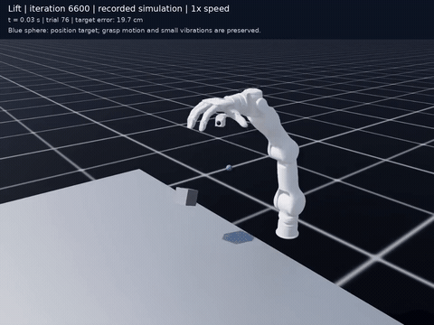
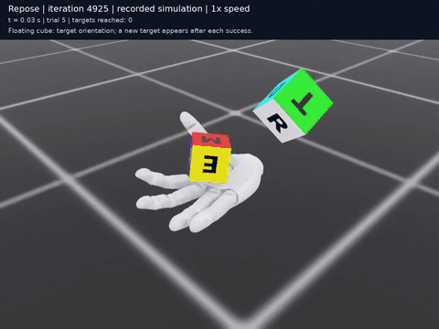
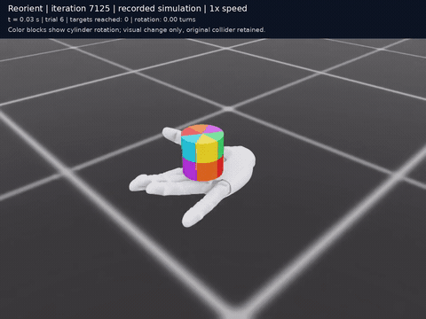
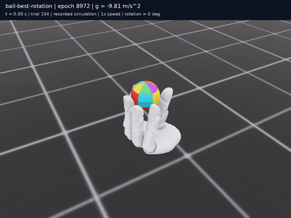
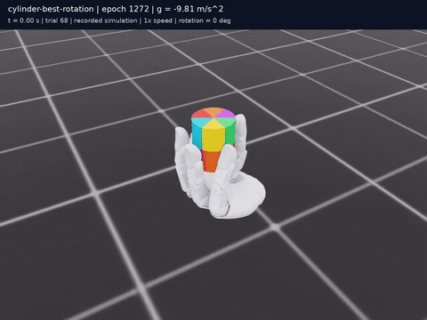
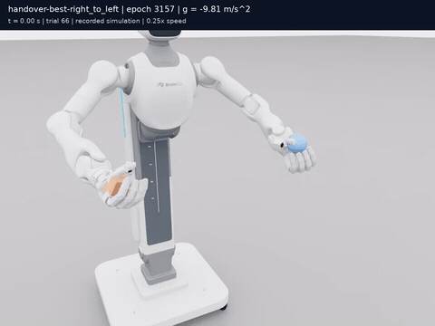

# RevoLab

Isaac Lab environments and learning code for BrainCo Revo3 dexterous hands and Revotron arm-hand systems.
Robot descriptions are supplied by the pinned [brainco-description](https://github.com/BrainCoTech/brainco-description) submodule.

The current task suite is **v1**, using the 20261014 asset release. This training campaign is complete: all six tasks have successful simulation demos below, and all campaign training has stopped. Completion means a successful demonstration was recorded for each task; it does not require every rollout to succeed. No v1 pretrained weights or validated hardware deployment results are published yet.

## Version history and v0 compatibility

The earlier README, simulation demos, pretrained checkpoints and deployment instructions are preserved on the [v0 branch](https://github.com/BrainCoTech/RevoLab/tree/v0), at commit [`bc2f874`](https://github.com/BrainCoTech/RevoLab/commit/bc2f874a61f386712374888675e6756316d0aadc) (`bc2f874a61f386712374888675e6756316d0aadc`). See the [original v0 README](https://github.com/BrainCoTech/RevoLab/blob/bc2f874a61f386712374888675e6756316d0aadc/README.md) for those results and their setup instructions.

The v1 demos below come from retraining all six tasks with the updated assets. The pretrained checkpoints published with v0 belong to the legacy task suite; they are not the policies shown in the current demos.

| Version | Robot assets and tasks | Policy artifacts |
| --- | --- | --- |
| `v0` (historical snapshot) | Robot assets bundled under `assets/`; `-v0` task IDs | Original pretrained checkpoints and HORA grasp caches |
| `main` (v1) | Pinned `brainco-description` 20261014 release; `-v1` task IDs | Retrained policies shown below; pretrained weights not yet published |

**v0 checkpoints and grasp caches are incompatible with v1.** The asset update changed finger axes and limits, inertial frames, collision geometry and fixed-joint merging, affecting task dynamics and observations. Renaming a task ID or copying an old checkpoint into `main` does not migrate a policy. Use v0 assets, code and configurations together when reproducing the earlier results. New v1 runs require matching `params/asset_contract.json` metadata; see the [asset contract and migration details](docs/assets.md).

To use the historical version in a separate checkout:

```bash
git clone --branch v0 https://github.com/BrainCoTech/RevoLab.git RevoLab-v0
cd RevoLab-v0
git checkout --detach bc2f874a61f386712374888675e6756316d0aadc
```

Follow the README in that checkout for installation, checkpoint downloads and evaluation. Its deployment instructions describe the v0 setup; validated v1 hardware deployment results remain pending.

## Tasks

| Task ID | Training entry point | Robot asset | Policy status |
| --- | --- | --- | --- |
| `BrainCo-Direct-Revo3-Repose-Cube-v1` | RSL-RL | Revo3 right hand | Successful demo recorded; training stopped |
| `BrainCo-Direct-Revo3-Reorient-Cylinder-v1` | RSL-RL | Revo3 right hand | Successful demo recorded; training stopped |
| `BrainCo-Dexsuite-Revo3-Right-Lift-v1` | RSL-RL | Revotron single right arm + Revo3 | Successful demo recorded; training stopped |
| `BrainCo-Direct-Revo3-HoraRotate-Ball-v1` | HORA PPO / ProprioAdapt | Revo3 right hand | Stage 1 complete; no further training planned in this campaign |
| `BrainCo-Direct-Revo3-HoraRotate-Cylinder-v1` | HORA PPO / ProprioAdapt | Revo3 right hand | Stage 1 complete; no further training planned in this campaign |
| `BrainCo-Dynamic-Handover-Revo3-Cube-v1` | RL-Games | Revotron bimanual + Revo3 | Training complete; right-to-left transfer demonstrated |

Lift and handover also provide `-Play-v1` configurations. Handover locks the waist, neck and head at zero; actions control the 56 arm and finger joints.

## Simulation demos

Training status and evaluation below are from **2026-10-19**. Lift, Repose and Reorient were stopped after their demos were recorded; checkpoints and training logs are retained. The GIFs show selected successful simulation episodes or excerpts, not hardware results.

| Lift | Repose · random cube orientations | Reorient · successive cylinder orientations |
| --- | --- | --- |
|  |  |  |
| 4 s; iteration 6600 | 8 s excerpt; iteration 4925; 14 targets in the full 10 s rollout | 8 s excerpt; iteration 7125; 229 targets in the full 10 s rollout |

These three clips show normal-speed rollouts from checkpoints collected during training. Lift brings the object to the blue position target; the original small vibrations remain visible. Repose's floating cube shows the current target orientation. Reorient advances the target yaw by 22.5° after each success; color blocks are added for display so its rapid rotation is visible. Robot and object motion is replayed directly from recorded simulation states, without interpolation or motion editing.

| HORA Ball · Stage 1 | HORA Cylinder · Stage 1 | Handover · right to left |
| --- | --- | --- |
|  |  |  |
| 8 s excerpt at normal speed; about 2 turns in the full 20 s rollout | 8 s excerpt at normal speed; about 2.5 turns in the full 20 s rollout | 1.25 s episode, shown at 0.25× speed |

The ball and cylinder use color blocks to make rotation visible. Only their visual surfaces change: the original analytic colliders, mass, inertia and friction are preserved. The animations replay recorded simulation states with the new appearance. Handover transfers the orange cube; the blue sphere marks its target.

For the checkpoints shown, a fixed-seed evaluation with 128 environments per condition gave:

| Policy | Checkpoint epoch | Evaluation result |
| --- | ---: | --- |
| HORA Ball | 8972 | 47/128 (36.7%) held for 20 s and rotated at least one turn |
| HORA Cylinder | 1272 | 124/128 (96.9%) held for 20 s and rotated at least one turn |
| Handover | 3157 | Right to left: 93/128 (72.7%); left to right: 0/128 |

HORA is the learning pipeline adapted from [In-Hand Object Rotation via Rapid Motor Adaptation](https://github.com/HaozhiQi/hora), used here for the ball and cylinder rotation tasks. Stage 1 trains a PPO teacher with privileged simulation observations. Stage 2 trains an adaptation module to infer the teacher's latent physical information from observation history; it is a second training stage for the same tasks.

The HORA tasks use normal gravity (9.81 m/s²), grasp caches and domain randomization. Rotation is signed cumulative rotation along the target axis; holding requires no height termination during the 20 s episode. Both demonstrated policies are Stage 1 teachers; Stage 2 adaptation has not been trained and is outside this campaign's scope. No further training is planned in this campaign.

Handover success here requires release by the source hand, proximity to the receiving palm and target, low object speed, and at least two nearby fingertips, continuously for at least 0.20 s through the episode end. This is a geometric reception check over a short episode, not a contact-force or long-duration stability test. Its reset is nearly fixed, so the 128 environments do not represent 128 independent starting scenes. The current policy has not learned reliable bidirectional handover; the equal-direction aggregate is 93/256 (36.3%).

## Setup

The target environment is **Isaac Sim 5.1, Python 3.11** and the pinned Isaac Lab commit documented in [remote environment setup](docs/remote-training.md), on Linux with an NVIDIA GPU. The tested checkout's VERSION file says 2.3.2, but it is newer than that release tag. This repository is an editable Isaac Lab extension; a standalone wheel does not include robot assets.

```bash
git clone https://github.com/BrainCoTech/RevoLab.git
cd RevoLab
# Install Git LFS using your OS package manager first.
bash scripts/setup_assets.sh
# Run with the Python environment configured for Isaac Lab:
python -m pip install -e source/BrainCo_DexHand
```

`setup_assets.sh` checks out the gitlink recorded by RevoLab and fetches LFS objects. Updating the submodule to a newer upstream commit is a deliberate code change; do not use `git submodule update --remote` for routine setup.

## Validation without training

Offline checks require only the USD Python bindings:

```bash
python -m pip install usd-core
python scripts/check_assets.py
```

In the Isaac Lab Python environment, reset and step a task with zero actions:

```bash
python scripts/smoke_tasks.py --task BrainCo-Direct-Revo3-Repose-Cube-v1 --num_envs 2 --steps 32 --headless
```

Use any task ID from the table. The check validates finite outputs, default joint limits, named palm frames, and the handover joint locks. It does not measure task success or policy performance. CI runs the offline check; GPU checks run separately in Isaac Sim. See the [local validation record](docs/asset-migration-validation.md) for the tested build and results.

The colored HORA objects also have a GPU comparison against their plain counterparts:

```bash
python scripts/check_rotation_visuals.py --headless
```

This checks cloned visuals, unchanged physics attributes, one collider per object, matching mass/inertia/materials, and matching motion through 120 fall-and-contact steps.

Remote environments and all six tasks have also been checked on three GPU servers; see the [remote validation record](docs/remote-validation.md) and [server setup and launch commands](docs/remote-training.md).

## Learning entry points

Use the Isaac Lab Python environment for training:

```bash
python scripts/rsl_rl/train.py --task BrainCo-Direct-Revo3-Repose-Cube-v1 --headless
python scripts/rsl_rl/train.py --task BrainCo-Direct-Revo3-Reorient-Cylinder-v1 --headless
python scripts/rsl_rl/train.py --task BrainCo-Dexsuite-Revo3-Right-Lift-v1 --headless
python scripts/rl_games/train.py --task BrainCo-Dynamic-Handover-Revo3-Cube-v1 --headless
python scripts/hora/train.py --algo PPO --task ball --cache_file /path/to/new-ball-cache.npz --headless
python scripts/hora/train.py --algo PPO --task cylinder --cache_file /path/to/new-cylinder-cache.npz --headless
python scripts/hora/train.py --algo ProprioAdapt --task ball --checkpoint /path/to/stage1_nn/best.pth --headless
```

Each new run writes `params/asset_contract.json` with the asset commit, ordered joints, limits and observation/action spaces. Resume, evaluation and export require matching metadata. Keep this file together with checkpoints when moving a run. See [asset conventions](docs/assets.md) for HORA cache format and migration details.

## Layout

```text
third_party/brainco-description/  # Pinned upstream robot descriptions (submodule)
assets/                         # Task objects and ground only
source/BrainCo_DexHand/          # Isaac Lab tasks, asset adapters and HORA algorithms
scripts/                        # Setup, validation, training and export
checkpoints/                    # Artifact status; generated weights are ignored
deploy/revo3/                   # ONNX deployment tooling; new calibration is pending
docs/                           # Asset contracts and migration validation
tests/                          # Offline regression checks
LICENSES/                       # Upstream license texts
```

See the [documentation index](docs/README.md), [changelog](source/BrainCo_DexHand/docs/CHANGELOG.rst) and [contribution guide](CONTRIBUTING.md).

RevoLab code is [MIT licensed](LICENSE), with third-party code and assets described in [THIRD_PARTY_NOTICES.md](THIRD_PARTY_NOTICES.md). Issues and contributions are welcome.
